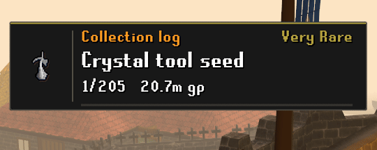

# Collection Log Showcase

**A standalone fork of [Collection Log Popup Enhanced](https://runelite.net/plugin-hub/show/collection-log-popup-enhanced) by SnakeSteak.** Huge thanks to SnakeSteak for the original plugin and the functionality this fork builds on. [View the original project](https://github.com/TimHeessels/collection-log-popup-enhanced).

## What it does

Celebrate new collection log slots with a sliding drawer reveal, clear pixel text and a matching collapse animation. The popup shows the item, rarity, available drop rate or rate range, and its value in compact GP units. Zero-value prices stay hidden.

- Optional ownership percentage and matching kill/activity counts.
- Adjustable size, duration, opacity, text colours and progress bar, with optional shimmer and rarity glow.
- Rarity based on item value, player ownership, or both.
- Selectable creator voices, one volume control and optional single-sound handling for bulk unlocks.
- Chambers of Xeric loot censoring and delayed popups, carried over from the original plugin.

## Getting started

1. Enable **Collection log - New addition notification** and **New addition popup** in the game's settings. Showcase replaces the visible popup while keeping screenshot support.
2. Under **Popup / Mode**, choose **Showcase**, or **Native** to keep the standard game popup with your selected audio.
3. Preview and Loop start off on first activation. Choose a tier under **Preview** to try it. Each selection plays once; enable **Loop** to repeat. Preview counts are simulated for layout testing.

Drop rate is the default primary statistic. Ownership, kill/activity counts and glow are off by default. Counts appear on real unlocks only when matching game data is available; drop rates may be unknown or show a range.

CoX delay and chat censoring are off by default. Enable them to hide loot until the reward chest, storage or bank is opened. Avoid enabling overlapping features in CoX Special Loot Hider. Showcase and the original popup plugin cannot run together.

## Audio & credits

**The bundled audio files were pulled from other RuneLite plugins, not recorded for this project:**

- **C Engineer** (default): [C Engineer: Completed by m0bilebtw](https://github.com/m0bilebtw/c-engineer-completed).
- **B0aty**, two variants: [Boaty Hype Man by Devdeve](https://github.com/Devdeve/boatyHypeMan-plugin). Variant 1's leading silence has been trimmed.
- **Tedious**: [Tedious Collection Log by evaan](https://github.com/evaan/tedious-collection-log).
- **Odablock**: [Odablock by DapperMickie](https://github.com/DapperMickie/odablock-sounds).

Choose a **Voice** under **Audio files**. **Random** picks from all five bundled clips for each unlock, avoiding consecutive repeats. For **Custom WAV**, place your recording in `.runelite/plugin-data/collection-log-showcase/sounds/` and enter its filename. Existing custom sounds in the former `.runelite/collection-log-showcase/` folder are migrated automatically when custom audio is used. The original plugin's sound effects are not bundled.

SnakeSteak's original detection, rarity and drop-rate data handling, count tracking, unlock queue, bulk audio and CoX functionality form the foundation of this fork. We also retain its credits to C Engineer, Trailblazer audio and CoX Special Loot Hider (Karambtwo, Rikten X and Fraac).

See [LICENSE](LICENSE), [third-party notices](THIRD_PARTY_NOTICES.md) and [audio sources and licences](src/main/resources/licenses) for attribution and exact source revisions. No creator endorsement is implied.

Available on the [RuneLite Plugin Hub](https://runelite.net/plugin-hub/show/collection-log-showcase).
